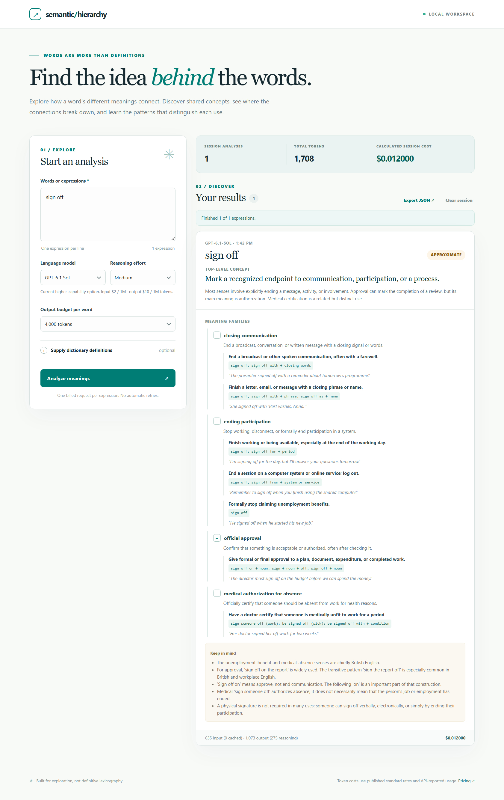

# Semantic Hierarchy

**Find the idea behind the words.** Semantic Hierarchy is a small, open-source application for exploring how the meanings of an English word or expression relate. It groups senses into semantic families, illustrates grammatical patterns with examples, and proposes a useful shared concept *when one exists*.

A single word can carry several unrelated meanings. The tool is designed to say **"no useful shared core"** rather than inventing a universal explanation.



[View the initial interface before analysis](docs/screenshot.png).

## Features

- **Local web interface** with multiline input, collapsible meaning families, examples, caveats, and responsive layout.
- **Model selector** with GPT-6 Luna, GPT-6 Sol, GPT-6.1 Sol, GPT-6.1 Terra, and a clearly marked legacy GPT-5 nano option (scheduled for retirement December 11, 2026).
- **Per-word usage and cost** calculated from actual input/output token counts returned by the API and published standard model prices. Reasoning tokens are included in output tokens, not double-counted.
- **Session summary**, including cumulative successful analyses, tokens, and calculated cost. Result history is stored only in the current browser tab's `sessionStorage` and can be cleared or exported as JSON.
- **Dictionary-guided analysis** by supplying definitions for one word, or a JSON mapping of definitions for multiple words.
- **CLI mode**, sharing the same analysis logic and pricing table as the web interface.
- **Conservative defaults**: maximum of 12 expressions per web submission, sequential requests, capped output tokens, no automatic retries, and local-only listening address.

## Windows: one-click launcher

Once you have installed dependencies (see Quick start below), **double-click `scripts/start.cmd`**. It starts the Python server on `127.0.0.1:8000`, waits until the server responds, and opens the app in your default browser. Keep the command window open while you use the app; press **Ctrl+C** in that window to stop the server.

If port 8000 is already in use, the launcher stops with a message rather than opening an unrelated service. From the project directory, choose another port with `.\scripts\start.cmd --port 8765`.

The launcher uses the project-local virtual environment and your existing `OPENAI_API_KEY` environment variable. It never embeds or saves credentials. To start without opening a browser, pass `--no-browser`.

## Quick start

Requirements: Python **3.10+**, an OpenAI API key authorized for the model you choose, and internet access for the API call.

```powershell
# Windows PowerShell
python -m venv .venv
.\.venv\Scripts\python.exe -m pip install -r requirements.txt

# OPENAI_API_KEY must already be set in this shell's environment.
.\scripts\start.cmd
```

The launcher opens **http://127.0.0.1:8000** automatically. If you prefer to run the server manually, use `.\.venv\Scripts\python.exe -m uvicorn web_app:app --host 127.0.0.1 --port 8000`. Opening `static/index.html` directly does not start the backend.

On macOS and Linux, use `python3 -m venv .venv`, `.venv/bin/python -m pip install -r requirements.txt`, and `.venv/bin/python -m uvicorn web_app:app --host 127.0.0.1 --port 8000`.

Set the `OPENAI_API_KEY` environment variable using your preferred environment configuration or secret manager. For example, a shell *that already has the key set* can start the app without any additional configuration. **Never commit credentials, embed them in a frontend, or put them in the README.**

### Using the interface

1. Enter one or more words/expressions, one per line (e.g., `sign off`, `run`, `bank`).
2. Choose a model and reasoning effort. Luna is a good inexpensive starting point; the selected model's published token rates appear below the selector.
3. Optionally expand **Supply dictionary definitions**. For one expression, enter a definition per line. For multiple expressions, use JSON such as:

   ```json
   {
     "sign off": ["End a broadcast", "Give formal approval"],
     "bank": ["A financial institution", "The edge of a river"]
   }
   ```

4. Select **Analyze meanings**. Each expression makes a separate request, and its result appears as soon as it completes. **Stop after current word** prevents the next request but cannot reverse an already-sent request.
5. Open or close meaning families, review caveats, export your session to JSON, or clear the session history.

The app never fetches dictionary definitions from external websites; supplied definitions must be entered manually. Be mindful of copyrighted or private dictionary material.

## Interpreting the results

Each result has a top-level concept, a **commonality** rating (`strong`, `approximate`, or `none`), meaning families with grammatical patterns and example sentences, and caveats. For `none`, the concept is `null` rather than a forced unification. The model may miss meanings or invent connections; use the output as a learning aid, not as an authoritative dictionary.

You can inspect or customize the analysis instructions in [the editable prompt](prompts/analysis.txt).

## Command-line usage

The existing CLI remains available:

```powershell
.\.venv\Scripts\python.exe semantic_hierarchy.py "sign off"
.\.venv\Scripts\python.exe semantic_hierarchy.py "run" "set" "bank"
.\.venv\Scripts\python.exe semantic_hierarchy.py "sign off" --definitions-file definitions.example.json
.\.venv\Scripts\python.exe semantic_hierarchy.py "sign off" --model gpt-6-sol --reasoning low
.\.venv\Scripts\python.exe semantic_hierarchy.py --file expressions.txt --output results/my-session.json
```

See `python semantic_hierarchy.py --help` for all CLI flags. CLI results are saved as structured JSON in `results/` by default; that directory is gitignored.

## Understanding costs

The OpenAI Responses API returns token counts, **not a per-request dollar charge**. Semantic Hierarchy calculates the standard nominal USD token cost from the API's actual usage values and a model-specific pricing table in [`pricing.py`](pricing.py):

```text
cost_usd = (
    (input_tokens - cached_input_tokens) * input_price_per_million
  + cached_input_tokens * cached_input_price_per_million
  + output_tokens * output_price_per_million
) / 1,000,000
```

Reasoning tokens are already part of `output_tokens`. Costs are therefore **calculated from measured usage** rather than a token-count guess, but they are **not an exact invoice**. Provider pricing changes, service tiers, taxes, regional adjustments, and failed or incomplete requests may change actual billing. Values for unsupported model IDs are reported as unavailable rather than guessed. Rates last reviewed **November 9, 2026**; verify [current OpenAI pricing](https://developers.openai.com/api/docs/pricing) before using the tool at scale.

The session total includes successful responses with available usage. Failed requests may still incur charges without usable token counts. The app does not run batch API calls and prices at standard short-context rates.

## Privacy and security

- The API key stays in the **Python process environment** and is never sent to the browser. The browser calls the local backend, which makes requests to OpenAI.
- The server must be started on **`127.0.0.1`**. Trusted-host validation and same-origin restrictions provide defense in depth, but this project is **not intended for public network deployment** or multiuser hosting.
- Model inputs and outputs are sent to the selected external API service. Requests use `store=False` and disable SDK retries.
- The browser stores result history only in **tab-scoped sessionStorage**, not a server database. The exported JSON file is downloaded only if requested. Browsers may restore tabs; clear the session if that matters for your privacy.
- Generated results, virtual environments, `.env*`, and common secret file formats are excluded by `.gitignore`. Review `git diff --cached` before publishing.
- The UI renders generated content as **text**, not executable HTML, to reduce injection risks.

## Project layout

```text
semantic_hierarchy.py      Responses API analysis and CLI
pricing.py                 Model catalog and measured-usage cost math
web_app.py                 Local FastAPI endpoints and input validation
static/index.html          Web interface
static/style.css           Responsive styling
static/app.js              UI, requests, progress, history, export
scripts/start.cmd           Windows double-click launcher
scripts/start.py            Server readiness and browser launcher
prompts/analysis.txt       Editable semantic analysis instructions
tests/                     Offline tests (no API charges)
.github/workflows/ci.yml   Automated test and lint workflow
requirements-dev.txt       Optional development dependencies
definitions.example.json   Example dictionary input
docs/screenshot-with-answer.jpg  Full example analysis screenshot
docs/screenshot.png              Empty interface screenshot
docs/architecture.md       How the components fit together
```

## Development and testing

Install the optional developer tools with `python -m pip install -r requirements-dev.txt`. Then run:

```powershell
.\.venv\Scripts\python.exe -m ruff check .
.\.venv\Scripts\python.exe -m ruff format --check .
.\.venv\Scripts\python.exe -m unittest discover -s tests -v
```

[GitHub Actions](.github/workflows/ci.yml) runs these checks on Linux and Windows with Python 3.10 and 3.13. The offline tests mock provider responses and never require a key or paid API calls. A manual live model request is billable.

Generated hierarchies are pedagogical hypotheses, not definitive linguistic facts. Verify uncertain uses against reliable dictionaries.

## Contributing

Bug reports and pull requests are welcome. See [CONTRIBUTING.md](CONTRIBUTING.md) for development instructions, the [architecture guide](docs/architecture.md) for the request flow, and [SECURITY.md](SECURITY.md) for the local-only security model.

## License

[MIT License](LICENSE).
